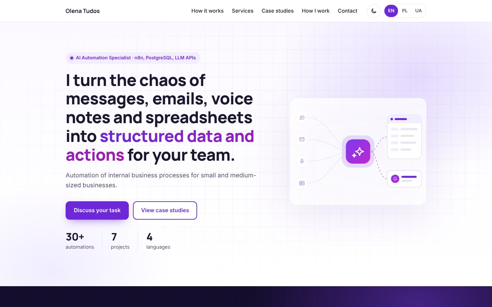
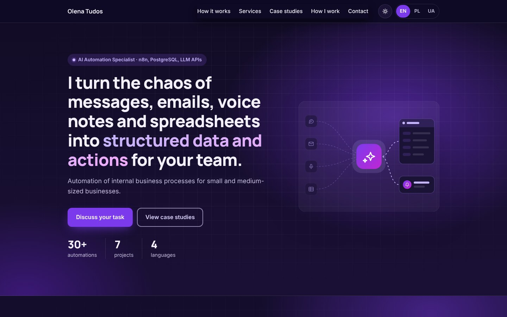
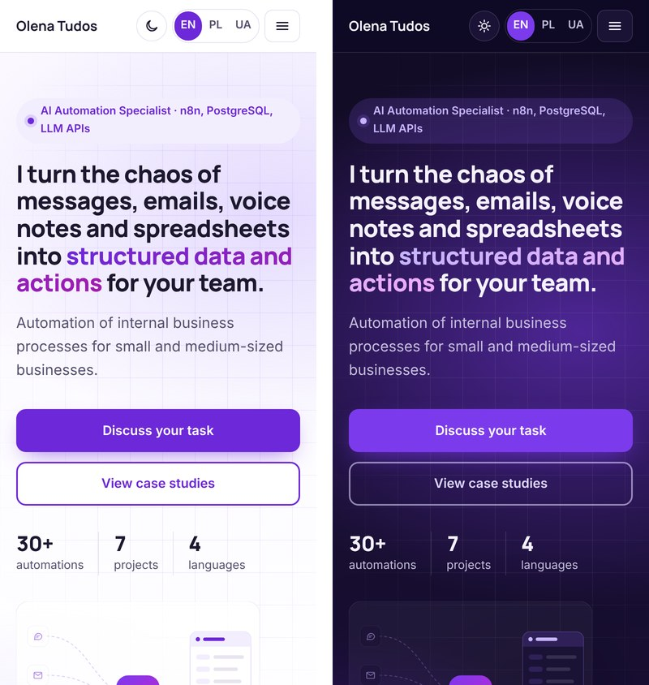

# olena-tudos-site

**Live site: [olena-tudos-site.vercel.app](https://olena-tudos-site.vercel.app)**

Personal landing page of **Olena Tudos**, AI Automation Specialist (n8n, PostgreSQL, LLM APIs).
Automation of internal business processes for small and medium-sized businesses.

The page explains what Olena does, shows her case studies and lets visitors get in touch.



<details>
<summary>Dark theme and phone</summary>





</details>

## Features

- Four languages: English (default), Polish, Ukrainian and Russian, with a language switcher
- Light and dark themes with a toggle; the first visit follows the system setting
- Single page, mobile-first, accessible (contrast, keyboard navigation, screen reader labels)
- Animated hero scene, animated "How it works" flow and HTML/CSS mock-ups of case study results, all without libraries and all disabled when the visitor prefers reduced motion
- Works without JavaScript (in English)
- Inquiry form with AI triage: Claude sorts each inquiry into a strict JSON structure and Olena gets it in Telegram; the visitor sees a short automatic reply
- SEO and link previews (title, description, Open Graph image 1200×630) written directly in HTML
- No cookies, no analytics, no third-party requests: fonts are served from the site itself

## Tech stack

- **Plain HTML, CSS and JavaScript**: no frameworks, no libraries, no bundler
- **Translations**: one file per language in `i18n/` (`en.js`, `pl.js`, `uk.js`, `ru.js`), loaded at runtime; script files rather than JSON so the page also opens straight from disk
- **Prerendered English**: `scripts/prerender.js` writes the English texts into `index.html`, so the page works without JavaScript and search engines see the content
- **Animations**: SVG SMIL for the hero scene, CSS keyframes elsewhere, paused off-screen
- **Font**: [Manrope](https://github.com/sharanda/manrope) (SIL Open Font License), self-hosted in `assets/fonts/`
- **Inquiry form**: Vercel serverless function `api/lead.js` (Node.js, EU region `fra1`) with the official Anthropic SDK and `zod`; model `claude-haiku-5-5` with structured outputs; Telegram Bot API for delivery
- **Hosting**: Vercel (Hobby plan)

Local checks before release: Lighthouse 99–100 in Performance and 100 in Accessibility, Best Practices and SEO on both mobile and desktop, and no axe-core accessibility violations in either theme or any language.

## Project structure

```
index.html            the page (English text generated from i18n/en.js)
css/styles.css        all styles, light and dark theme variables
js/i18n.js            translation loader and language switcher
js/main.js            mobile menu and theme toggle
js/motion.js          hero scene control, counter, reveal on scroll
js/form.js            inquiry form: validation, sending, result
api/lead.js           POST /api/lead (serverless function)
api/_lib/             validation, Claude classification, Telegram, flow
i18n/                 en.js, pl.js, uk.js, ru.js
content/facts.md      the single source of truth for all content
assets/               favicon, Open Graph image, fonts
scripts/              translation check, English prerender, form tests
docs/                 screenshots for this README, test log
```

## Run locally

Open `index.html` in a browser. No build step or server is needed.

After changing texts, check the translations and update the English text in the HTML:

```bash
node scripts/check-i18n.js
```

```bash
node scripts/prerender.js
```

## Inquiry form

```
form ──POST /api/lead──► validate, consent, bot checks
                         ├─ Claude (claude-haiku-5-5) → strict JSON: service, process,
                         │  department, urgency, team size, summary, first question, reply
                         │  └─ any failure → the lead is forwarded as raw text
                         ├─ Telegram → message to Olena (⚠️ for spam, injection or no AI)
                         └─ visitor: automatic reply or a neutral confirmation
```

The visitor's text is treated as data, never as instructions: it is sent as escaped JSON inside `<inquiry>` tags, the output is limited by a strict schema, and model text is shown only as plain text. Full rules: the *Inquiry form* section of [CLAUDE.md](CLAUDE.md).

### Setup on Vercel

1. Create a Telegram bot with [@BotFather](https://t.me/BotFather) (`/newbot`) and copy the token. Send the bot any message, open `https://api.telegram.org/bot<token>/getUpdates` and copy `chat.id`.
2. Create an API key in the [Anthropic Console](https://console.anthropic.com) and set a monthly spend limit.
3. In Vercel → Project → Settings → Environment Variables, add `ANTHROPIC_API_KEY`, `TELEGRAM_BOT_TOKEN` and `TELEGRAM_CHAT_ID` for **Production** and **Preview** (names are in [.env.example](.env.example)), then redeploy.

### Tests

Mocked tests (no network, no cost), run before every change to the form:

```bash
npm install
```

```bash
npm test
```

Live tests against a **Preview** deployment (real Claude and Telegram; 12 messages marked `[TEST]` arrive in Telegram; costs a fraction of a cent). Node 20+ is enough, no `npm install` needed:

1. Push the branch; Vercel builds a Preview deployment. Copy its address from Vercel → Deployments (for example `https://olena-tudos-site-git-<branch>-<team>.vercel.app`).
2. Preview deployments are usually protected by Vercel Authentication. Create a bypass secret in Vercel → Settings → Deployment Protection → *Protection Bypass for Automation*. If that option is not offered on your plan, turn Vercel Authentication off for Preview while testing and back on afterwards.
3. Run:

```bash
PREVIEW_URL=https://your-preview.vercel.app VERCEL_BYPASS=your-secret node scripts/live-test-lead.mjs
```

To check the fallback when Claude is unavailable, set `ANTHROPIC_API_KEY` for Preview to a wrong value, redeploy, run the command below, then restore the key and redeploy:

```bash
PREVIEW_URL=https://your-preview.vercel.app VERCEL_BYPASS=your-secret node scripts/live-test-lead.mjs --ai-down --only valid-en,spam
```

The script refuses to run against the production domain.

Results of live tests, problems found and fixes are recorded in the [test log](docs/test-log.md).

## Built with Claude Code

This site was built together with [Claude Code](https://claude.com/claude-code), Anthropic's AI coding agent, in a series of small, reviewed steps.

- **Rules first.** Before any code, the project rules were written down in [CLAUDE.md](CLAUDE.md): languages, stack, accessibility, security, hosting, positioning and the order of case studies. Claude Code reads this file at the start of every session, so the same rules apply to every change.
- **One source of truth.** All content comes from [content/facts.md](content/facts.md), written by Olena. Claude Code was not allowed to invent facts, figures, clients or testimonials; every number on the page is traced back to that file, and figures from tests or estimates are labelled as such.
- **Plan, change, verify.** Each change started with a short plan and ended with a summary and a way to check it. Visual changes were verified in a headless browser at phone (320–390 px) and desktop widths, with screenshots reviewed before moving on; design directions were shown as two prototypes before one was chosen.
- **Automated checks.** `scripts/check-i18n.js` makes sure all four languages have the same, non-empty keys and that every key used in the HTML exists; `scripts/prerender.js --check` makes sure the HTML matches the English translation. Lighthouse and axe-core were run before release.
- **Small commits.** Every logical change is a separate commit with a clear English message, so the history reads as a log of decisions.

## Project rules and secrets

See [CLAUDE.md](CLAUDE.md). Secrets are stored only in Vercel environment variables, never in this repository.
